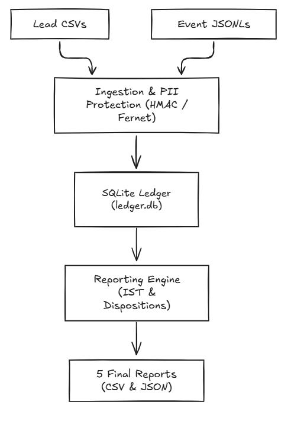

# Submission

## Candidate
- **Name:** Manohar Sonsale
- **Assignment chosen:** A-Interaction Ledger & Reporting Pipeline (Data)
- **Time spent (honest estimate):** ~8–10h

## How to run

```bash
# 1. Environment setup (requires Python 3.11+)
python -m venv .venv
source .venv/bin/activate  # on Windows PowerShell: .venv\Scripts\Activate.ps1
pip install -r requirements.txt

# 2. Set PII encryption key (required; pipeline exits with error if unset)
# Generates a random 32-byte secret for the terminal session:
export AU_SECRET_KEY="$(python -c 'import secrets; print(secrets.token_urlsafe(32))')"
# on Windows PowerShell:
# $env:AU_SECRET_KEY = python -c "import secrets; print(secrets.token_urlsafe(32))"
# Note: Any persistent string (e.g. export AU_SECRET_KEY="my-secret") also works.

# 3. Generate data (not included in clone; uses seed 42 or any seed)
python assignment-a-data/tools/generate_data.py --seed 42 --scale small --out data
# Optional performance stretch goal (~140k leads, ~600k events):
# python assignment-a-data/tools/generate_data.py --seed 42 --scale large --out data_large

# 4. Ingest drops in order (idempotent if re-run)
python -m solution.pipeline --db ledger.db ingest data/drop_1
python -m solution.pipeline --db ledger.db ingest data/drop_2

# 5. Generate the five report files
python -m solution.pipeline --db ledger.db report --out reports/

# 6. Run automated tests
python -m pytest solution/tests/ -v
```

## Design

I structured the solution around a CLI pipeline (`solution/pipeline.py`) backed by an embedded SQLite database using WAL mode and foreign key enforcement.

The pipeline runs in two clear phases:
- **Ingestion (`ingest`):** Reads CSV files from `leads/<workflow_id>/` and JSONL files from `events/`. It normalizes headers and values against schema definitions, validates business rules, strips PII, and commits all changes for the drop in a single database transaction.
- **Reporting (`report`):** Reads the stored interaction ledger, converts UTC event timestamps to IST (`+05:30`), calculates call facts and effective dispositions, and writes the five required report files (`batch_summary.csv`, `daily_overview.csv`, `lead_report.csv`, `rejections.csv`, and `data_quality.json`).

For PII protection, I made sure plaintext names and phone numbers are never stored in the database. Phones are hashed with HMAC-SHA256 to allow fast indexed lookups for deduplication and event linking. Customer names and last-4 phone digits are encrypted using Fernet (AES-128-CBC with HMAC). Event payloads have schema-defined PII keys stripped before saving.



### Database Schema
I designed six tables to separate clean records from quarantined or rejected data:
- `leads`: Stores unique leads keyed by `(workflow_id, phone_hash)`. It keeps the initial `batch_id` permanently, encrypted PII, external reference, and merged attribute fields.
- `events`: Append-only interaction ledger linked to `leads` via `lead_id`. Holds valid events (`call.initiated`, `call.connected`, etc.). Unknown dispositions are stored here with `is_ignored = 1` so they remain in the ledger but are excluded from report calculations.
- `orphan_events`: Holds events that arrived before their corresponding lead, or overrides whose call hasn't appeared yet. I intentionally left out any `raw_json` column here to avoid leaking raw phone numbers.
- `rejections`: Stores lead rows that failed schema validation (`workflow_id`, `batch_id`, `row_number`, `reason`), containing zero PII.
- `drops_ingested`: Tracks resolved paths of ingested drop directories, providing clean drop-level idempotency.
- `data_quality`: Stores cumulative counters for row, event, rejection, and duplicate statistics.

## Decisions & assumptions

| Decision | Why | Alternative considered |
|---|---|---|
| Use SQLite (stdlib `sqlite3`) instead of PostgreSQL | Zero setup overhead, single-file portability, and handles small/medium batches easily with WAL mode enabled. | PostgreSQL via Docker Compose, which adds network and container dependencies. |
| Use HMAC-SHA256 for phone lookup + Fernet for name and phone last-4 | Gives fast O(1) indexed lookups on `(workflow_id, phone_hash)` without keeping plaintext numbers in the DB. | Reversible encryption on the full phone, which would require decrypting every lead to find a match. |
| Require `AU_SECRET_KEY` in environment and fail fast if missing | Prevents accidental runs with insecure hardcoded defaults or per-run random keys that break cross-drop matching. | Auto-generating a local secret key file, which could easily be lost or committed by mistake. |
| Store unknown dispositions in `events` with `is_ignored = 1` | Keeps the interaction ledger strictly append-only and ensures duplicate deliveries of the same event are dropped at step 2 instead of re-counted as unknown. | Dropping the event immediately without saving it to the database. |
| Compute effective dispositions and call buckets at report time | Avoids saving stale materialized states when out-of-order events or overrides arrive across different drops. | Updating lead and call status fields incrementally on every event insert. |
| Break exact timestamp ties on `disposition.*` events using `event_id` | Guarantees deterministic report output even if events share the exact same second and JSONL lines are reordered. | Using database insertion order (`event_row_id`), which depends on file read order. |
| Track ingested drops by resolved directory path | Makes re-running `ingest <drop>` an immediate O(1) no-op without re-processing files. | Hashing all files inside the drop on every run. |
| Store timestamps in UTC internally, convert to IST at report time | Eliminates timezone and offset parsing bugs inside SQL queries while meeting the IST reporting requirement. | Storing raw string timestamps directly from the input JSONL. |

## Failure modes considered

**Handled:**
- **Mid-drop crashes:** Each drop is wrapped in a single SQLite transaction with `drops_ingested` updated last. If the process crashes or encounters an error, the database rolls back to its exact pre-drop state.
- **Re-running the same drop:** The pipeline checks `drops_ingested` and exits with code 0 without re-inserting records or incrementing counters.
- **Events arriving before leads:** Unmatched events are safely quarantined in `orphan_events`. After each drop, a two-pass reconciliation links them when the lead or parent call arrives.
- **Missing or bad environment keys:** If `AU_SECRET_KEY` is missing or invalid, the CLI exits immediately with code 2 and a clear error message.
- **Malformed or dirty input data:** Malformed JSON lines, duplicate event IDs, invalid phone formats, missing required fields, and unknown disposition codes are caught, logged in metrics, and handled without stopping the pipeline.

**Known limitations (not handled):**
- **Key rotation:** Changing `AU_SECRET_KEY` between drops will break HMAC phone matching for previously ingested leads, as there is no built-in re-encryption script.
- **Modified files inside an ingested drop:** If a user edits files inside an already ingested drop folder, the pipeline will still skip it because it tracks the directory path.
- **Large-scale memory limits:** Reporting loads lead and event facts into memory for aggregation, which works well for small scales but may need SQL views or streaming for `--scale large`.

## Testing

- **Automated test suite (`pytest solution/tests/ -v`):**
  - **133 tests passed** in ~2.6 seconds.
  - Covers phone normalization (11 valid formats, 13 invalid formats), date parsing (ISO, day-first, month names), currency and decimal parsing, enum validation, schema loading, HMAC/Fernet PII handling, lead deduplication and merging, event deduplication, two-pass orphan reconciliation, effective disposition precedence, bucket priorities, exact CSV headers/sorting, and drop idempotency.
  - *Python version note:* Tests were verified locally under Python 3.10.0. The code uses standard typing (`from __future__ import annotations`, pipe unions), but I did not have a local Python 3.11 environment available to test directly on 3.11.
- **Manual pipeline execution:**
  - Ingested `drop_1` followed by `drop_2` and generated reports using synthetic datasets generated from `--seed 42` and `--seed 99` (`scale=small`).
  - Tested idempotency by re-running `drop_1` and verifying all generated files and counts remained identical.
  - Inspected SQLite tables directly to confirm no plaintext customer names or full phone numbers were saved.
- **What was not tested:**
  - `--scale large` (~140k leads, ~600k events) was not run due to local resource and execution time limits.
  - Concurrent multi-process writes to the same SQLite database file were not tested.

## Results

Tested locally on Windows 11 with Python 3.10.0 and SQLite 3.

- **Seed 42 (`scale=small`, `drop_1` + `drop_2` + `report`):**
  - Runtime: ~5.5s total.
  - Leads: 1,892 accepted, 108 rejected, 57 duplicates merged, 122 field warnings (2,057 total rows read).
  - Events: 8,038 linked, 462 unresolved orphans, 8 malformed, 237 duplicate events dropped, 18 unknown dispositions (8,745 total lines).
  - All 5 report files generated with exact required headers and ordering.
- **Seed 99 (`scale=small`, `drop_1` + `drop_2` + `report`):**
  - Leads: 1,901 accepted, 99 rejected, 58 duplicates merged, 115 field warnings (2,058 total rows read).
  - Events: 8,218 linked, 472 unresolved orphans, 8 malformed, 268 duplicate events dropped, 14 unknown dispositions (8,966 total lines).
  - Exact accounting invariants held (`lead_rows_total` = accepted + rejected + merged).
- Large scale testing (`--scale large`) was not performed.

## If I had another day

1. **Benchmark and optimize for `--scale large`:** Implement batched database inserts (`executemany`) and cache active `(workflow_id, phone_hash)` lookups in memory to handle 100k+ rows efficiently.
2. **Move report aggregations into SQL:** Replace in-memory Python calculations with SQLite window functions and aggregate queries to reduce memory footprint.
3. **Build a key rotation tool:** Create a utility script to re-encrypt Fernet fields and re-hash phones if the encryption key ever needs to change.
4. **Automate CI across Python versions:** Add a GitHub Actions workflow to run tests against Python 3.11, 3.12, and 3.13 on both Ubuntu and Windows.
